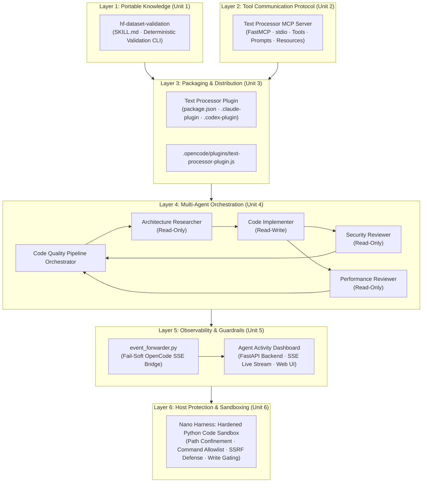

# Context Engineering Labs

[](https://huggingface.co/learn/context-course)
[-brightgreen.svg?style=for-the-badge&logo=pytest&logoColor=white)](tests/)
[](https://www.python.org)
[](https://opencode.ai)
[](LICENSE)

An enterprise-grade reference architecture, tool harness, and multi-agent orchestration portfolio implementing the complete context engineering stack from the official [Hugging Face Context Engineering Course](https://huggingface.co/learn/context-course).

---

## 📑 Executive Overview

**Context Engineering** is the discipline of structuring knowledge, tool interfaces, sandbox boundaries, and multi-agent coordination loops to maximize AI agent autonomy and reliability.

This repository publishes self-contained, production-tested implementations across the six core pillars of context engineering:
1. **Portable Knowledge (Agent Skills)**: Declarative, model-agnostic instructions conforming to the open Agent Skills specification.
2. **Dynamic Tool Protocols (Model Context Protocol - MCP)**: Standardized client/server tools, prompts, and resources running over JSON-RPC 2.0 `stdio`.
3. **Cross-Agent Packaging (Plugins)**: Redistributable bundles uniting skills, MCP servers, and code-first JavaScript lifecycle hooks.
4. **Multi-Agent Orchestration (Subagents)**: Role-specialized agents executing Sequential Handoff and Fan-Out / Fan-In review pipelines with read-only sandbox gating.
5. **Observability & Guardrails (Hooks)**: Real-time event streaming and telemetry aggregation powered by FastAPI and Server-Sent Events (SSE).
6. **Hardened Execution Sandbox (Nano Harness)**: Multi-layer host defense enforcing strict path confinement, command allowlists, write gating, and SSRF protection.

---

## 🏛️ System Architecture

The six units integrate hierarchically to form a complete autonomous agent operating environment:



---

## 📊 Project Matrix & Documentation Suite

Every unit includes a comprehensive **17-section README**, formal **ARCHITECTURE.md** specifications, **CONTRIBUTING.md** guides, **CHANGELOG.md** release notes, safe **.env.example** configurations, and automated test coverage.

| Unit & Focus | Implementation Project | Technology Stack | Complete Documentation Suite | Automated Tests | Status |
| :--- | :--- | :--- | :--- | :---: | :---: |
| **Unit 1: Agent Skills** | [`hf-dataset-validation`](unit-01-agent-skills/hf-dataset-validation/) | Python 3.12, JSON Schema, Datasets | [README](unit-01-agent-skills/hf-dataset-validation/README.md) · [ARCH](unit-01-agent-skills/hf-dataset-validation/ARCHITECTURE.md) · [CONTRIB](unit-01-agent-skills/hf-dataset-validation/CONTRIBUTING.md) · [LOG](unit-01-agent-skills/hf-dataset-validation/CHANGELOG.md) | **10 / 10** | `PASSED` |
| **Unit 2: MCP Protocol** | [`text-processor-mcp`](unit-02-mcp/text-processor-mcp/) | FastMCP, JSON-RPC 2.0, Gradio | [README](unit-02-mcp/text-processor-mcp/README.md) · [ARCH](unit-02-mcp/text-processor-mcp/ARCHITECTURE.md) · [CONTRIB](unit-02-mcp/text-processor-mcp/CONTRIBUTING.md) · [LOG](unit-02-mcp/text-processor-mcp/CHANGELOG.md) | **9 / 9** | `PASSED` |
| **Unit 3: Plugins** | [`text-processor-plugin`](unit-03-plugins/text-processor-plugin/) | ES2022, Node.js, Claude/Codex | [README](unit-03-plugins/text-processor-plugin/README.md) · [ARCH](unit-03-plugins/text-processor-plugin/ARCHITECTURE.md) · [CONTRIB](unit-03-plugins/text-processor-plugin/CONTRIBUTING.md) · [LOG](unit-03-plugins/text-processor-plugin/CHANGELOG.md) | **6 / 6** | `PASSED` |
| **Unit 4: Subagents** | [`code-quality-pipeline`](unit-04-subagents/code-quality-pipeline/) | Python, OpenCode REST, Nemotron | [README](unit-04-subagents/code-quality-pipeline/README.md) · [ARCH](unit-04-subagents/code-quality-pipeline/ARCHITECTURE.md) · [CONTRIB](unit-04-subagents/code-quality-pipeline/CONTRIBUTING.md) · [LOG](unit-04-subagents/code-quality-pipeline/CHANGELOG.md) | **11 / 11** | `PASSED` |
| **Unit 5: Hooks** | [`agent-activity-dashboard`](unit-05-hooks/agent-activity-dashboard/) | FastAPI, SSE, Web UI, Async JS | [README](unit-05-hooks/agent-activity-dashboard/README.md) · [ARCH](unit-05-hooks/agent-activity-dashboard/ARCHITECTURE.md) · [CONTRIB](unit-05-hooks/agent-activity-dashboard/CONTRIBUTING.md) · [LOG](unit-05-hooks/agent-activity-dashboard/CHANGELOG.md) | **9 / 9** | `PASSED` |
| **Unit 6: Nano Harness** | [`nano_harness`](unit-06-nano-harness/) | Python Sandbox, Subprocess, SSRF | [README](unit-06-nano-harness/README.md) · [ARCH](unit-06-nano-harness/ARCHITECTURE.md) · [CONTRIB](unit-06-nano-harness/CONTRIBUTING.md) · [LOG](unit-06-nano-harness/CHANGELOG.md) | **15 / 15** | `PASSED` |
| **Audit: System Integration** | [`tests/integration_audit_test.py`](tests/integration_audit_test.py) | End-to-End Live System Audits | [Master Projects Portfolio (PROJECTS.md)](PROJECTS.md) | **12 / 12** | `PASSED` |
| **Total Test Suite** | | | **All 6 Units + Integration Regression Suite** | **72 / 72** | **100% PASS** |

---

## ⚡ Quickstart & Installation

### 1. Clone the Repository
```bash
git clone https://github.com/naresh-cn2/context-engineering-labs.git
cd context-engineering-labs
```

### 2. Set Up Python Virtual Environment
Python 3.10+ is supported (tested on Python 3.12.10).

> [!TIP]
> **Windows WDAC / AppLocker Environments**: If your system enforces Windows Defender Application Control policies on local user directory `.pyd` extensions, inherit system site packages:
> ```powershell
> python -m venv --system-site-packages .venv
> .venv\Scripts\activate
> ```

On Linux / macOS:
```bash
python3 -m venv .venv
source .venv/bin/activate
```

### 3. Install Dependencies
```bash
python -m pip install --upgrade pip
pip install -r requirements.txt
```

---

## 🚀 Running the Practical Implementations

### Unit 1: Dataset Validation Skill
```bash
python unit-01-agent-skills/hf-dataset-validation/scripts/validate_dataset.py \
  --file unit-01-agent-skills/hf-dataset-validation/test_data/clean_sample.csv \
  --columns text label
```

### Unit 2: Text Processor MCP Server & UI
```bash
# Launch JSON-RPC 2.0 stdio server
python unit-02-mcp/text-processor-mcp/server.py

# Launch interactive Gradio interface (http://127.0.0.1:7860)
python unit-02-mcp/text-processor-mcp/app.py
```

### Unit 3: Cross-Agent Plugin Bundle
```bash
# Install directly into OpenCode via git/file specifier
opencode plugin add git+file://C:/Users/nares/workspace/context-engineering-labs

# Verify plugin initialization
opencode api GET /api/plugin
```

### Unit 4: Multi-Agent Code Quality Pipeline
```bash
# Fast deterministic simulated mode (for CI/CD without network)
python unit-04-subagents/code-quality-pipeline/pipeline_runner.py

# Live LLM orchestration mode (NVIDIA Nemotron via OpenCode server at cost: 0)
python unit-04-subagents/code-quality-pipeline/pipeline_runner.py --live
```

### Unit 5: Real-Time Observability & OpenCode Forwarder
```bash
# Terminal 1: Launch FastAPI dashboard (http://127.0.0.1:8000)
python unit-05-hooks/agent-activity-dashboard/app.py

# Terminal 2: Start native OpenCode SSE forwarder bridge
python unit-05-hooks/agent-activity-dashboard/event_forwarder.py
```

### Unit 6: Nano Harness Autonomous Agent Sandbox
```bash
python unit-06-nano-harness/nano_harness.py
```

---

## 🧪 Comprehensive Verification & Test Execution

Execute the unified 72-test suite across all unit projects and live integration audits:

```bash
python -m pytest -v
```

### Execution Log Evidence
```text
============================= test session starts =============================
platform win32 -- Python 3.12.10, pytest-9.2.0, pluggy-1.7.0
rootdir: C:\Users\nares\workspace\context-engineering-labs
plugins: anyio-4.16.0, platformdirs-4.13.5, asyncio-1.4.0, cov-7.1.0
collected 72 items

tests\integration_audit_test.py ............                             [ 16%]
unit-01-agent-skills\hf-dataset-validation\tests\test_validation.py .......... [ 30%]
unit-02-mcp\text-processor-mcp\tests\test_text_processor.py .........    [ 43%]
unit-03-plugins\text-processor-plugin\tests\test_plugin.py ......        [ 51%]
unit-04-subagents\code-quality-pipeline\tests\test_pipeline.py ........... [ 66%]
unit-05-hooks\agent-activity-dashboard\tests\test_dashboard.py ......    [ 75%]
unit-05-hooks\agent-activity-dashboard\tests\test_opencode_hook_integration.py ... [ 79%]
unit-06-nano-harness\tests\test_nano_harness.py ...............          [100%]

============================= 72 passed in 35.76s =============================
```

---

## 🛡️ Security & Sandboxing Architecture

Security audit details are documented in [docs/SECURITY_AUDIT.md](docs/SECURITY_AUDIT.md):

- **Principle of Least Privilege**: Subagents in Unit 4 (Security Reviewer, Performance Reviewer) are explicitly stripped of `Write` and `Edit` tools to eliminate accidental modifications or rogue merges during automated review turns.
- **Fail-Soft Hooks**: In Unit 5, all telemetry dispatchers use non-blocking HTTP requests with short cancellation timeouts. Telemetry outages will **never** cause agent execution halts or workflow crashes.
- **Path Confinement**: Unit 6 enforces canonical path containment via `resolve().relative_to(workspace)`, preventing relative escapes (`../../`), null bytes (`\0`), percent-encoded sequences (`%2e%2e`), and symlink escapes.
- **Shell Defense**: Subprocesses execute with `shell=False` against a strict binary allowlist, rejecting command chaining tokens (`;`, `&&`, `||`, `|`, `` ` ``, `$()`).
- **SSRF Protection**: `web_fetch` evaluates resolved DNS addresses and blocks loopback (`127.0.0.1`), private RFC1918 subnets, and cloud metadata endpoints (`169.254.169.254`).

---

## ⚠️ Important Disclaimers

> [!NOTE]
> - **Certification Notice**: This repository reflects independent engineering lab implementations. Official Hugging Face certificates are issued exclusively by [huggingface.co](https://huggingface.co/learn/context-course) upon completing interactive quizzes and submitting capstone deliverables.
> - **Dual Execution Modes**: Unit 4 provides both deterministic rule-based evaluation (for hermetic CI test runners) and live LLM multi-agent sessions (powered by OpenCode and free NVIDIA Nemotron reasoning models).
> - **In-Process vs OS Sandboxing**: Nano Harness demonstrates application-level security sandboxing in pure Python. For production untrusted code execution, pair this application layer with kernel-level containerization (Docker, gVisor, or Firecracker).

---

## 📜 Attribution & License

- **Curriculum**: Hugging Face Context Engineering Course by Ben Burtenshaw ([GitHub upstream](https://github.com/huggingface/context-course)).
- **License**: [Apache 2.0](LICENSE).
- **Author & Maintainer**: [Naresh](https://github.com/naresh-cn2).
