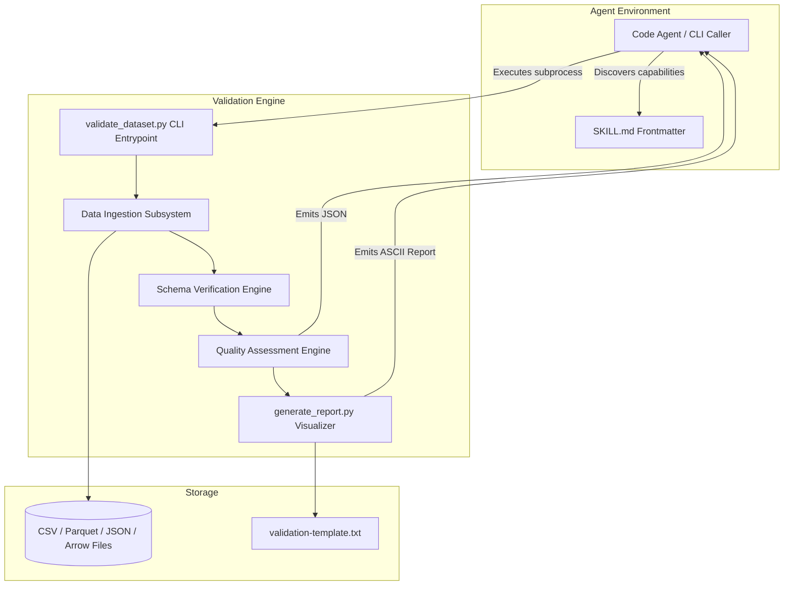

# Architecture: HF Dataset Validation Skill

## Component Diagram

## Data Ingestion & Type Resolution

`scripts/validate_dataset.py` uses heuristic and extension-based detection to route input files to appropriate loaders:
- `.csv`, `.tsv`, `.txt`: Loaded via `pandas.read_csv()`.
- `.parquet`, `.pq`: Loaded via `pyarrow.parquet.read_table()` or `pandas.read_parquet()`.
- `.json`, `.jsonl`: Loaded via `pandas.read_json()` supporting both standard arrays and line-delimited records.
- `.arrow`: Loaded via `pyarrow.ipc.open_file()`.

## Exit Code Taxonomy

The CLI adheres to strict POSIX exit code conventions essential for agentic loops:
- `0`: Execution succeeded without fatal errors. The dataset is structurally sound. Note that quality warnings (e.g. duplicate rows, null cells) still return `0` so downstream agents can decide whether to clean or proceed.
- `1`: Blocking failure. The file does not exist, is unparseable, or lacks mandatory columns required for the pipeline.
