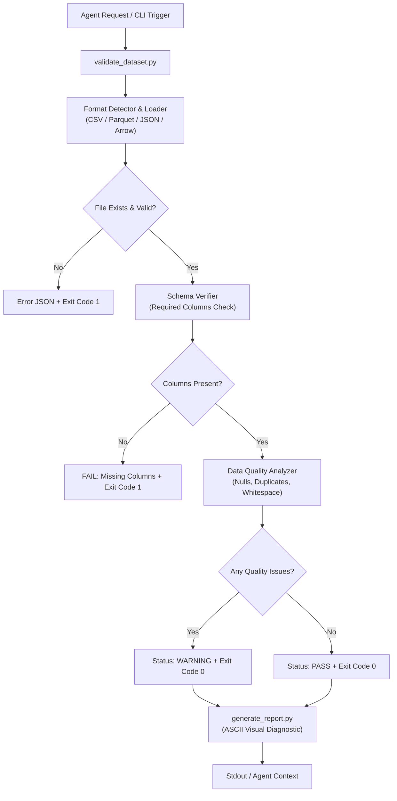

# Hugging Face Dataset Validation Skill (`hf-dataset-validation`)

> **Agent Skill for autonomous and programmatic dataset validation, schema enforcement, and data quality diagnostics.**

Compliant implementation for **Unit 1: Skills — Portable Knowledge for Code Agents** of the Hugging Face Context Engineering Course, built strictly according to the **[Agent Skills Specification](https://agentskills.io)**.

---

## 1. Problem Statement

Autonomous code agents operating on machine learning workflows frequently encounter malformed, empty, duplicate, or improperly formatted dataset files. Without standardized validation tools:
- Agents train on corrupted datasets leading to silent failure or degraded model performance.
- Custom ad-hoc validation scripts fail to handle varying serialization formats (CSV, Parquet, JSON, Arrow).
- Inconsistent CLI error handling causes agent loops to hang or misunderstand exit statuses.

`hf-dataset-validation` provides a standardized, progressive-disclosure skill that code agents (such as OpenCode, Claude Code, and Codex) can discover, invoke, and interpret reliably.

---

## 2. Objectives & Key Capabilities

- **Strict Specification Compliance**: Standardized YAML frontmatter (`name`, `description`, `parameters`) enabling auto-discovery by agent engines.
- **Multi-Format Ingestion**: Unified loading across CSV, Apache Parquet, JSON, JSON Lines, and Apache Arrow formats.
- **Schema Validation**: Deterministic checks for mandatory columns (defaulting to `text` and `label`).
- **Data Quality Diagnostics**: Rapid detection of missing/null values, duplicate rows, and empty or whitespace-only records.
- **Dual Output Modalities**:
  - Structured machine-readable JSON for automated agent tool calls and CI/CD pipelines.
  - Human-readable ASCII diagnostic reports with progress bars and column breakdowns.
- **Deterministic CLI Exit Codes**: Standardized exit codes (`0` for PASS/WARN, `1` for blocking fatal errors).

---

## 3. Architecture Overview



---

## 4. Technology Stack

- **Runtime**: Python 3.12+
- **Data Processing**: `pandas >= 1.3.0`, `pyarrow >= 14.0.0`, `datasets >= 2.0.0`, `numpy >= 1.20.0`
- **Testing & Validation**: `pytest >= 7.0.0`, `PyYAML >= 6.0`
- **Specification**: Agent Skills Specification (`SKILL.md`)

---

## 5. Repository Structure

```
hf-dataset-validation/
├── SKILL.md                     # Agent skill definition with YAML frontmatter
├── requirements.txt             # Pinned project dependencies
├── .gitignore                   # Workspace and bytecode exclusion rules
├── README.md                    # Comprehensive technical documentation
├── ARCHITECTURE.md              # Deep-dive architectural specification
├── CONTRIBUTING.md              # Developer contribution guidelines
├── CHANGELOG.md                 # Version and release history
├── .env.example                 # Example environment variables
├── scripts/
│   ├── validate_dataset.py      # Core dataset validation engine
│   └── generate_report.py       # Human-readable diagnostic report generator
├── references/
│   └── examples.md              # Interactive invocation and CLI examples
├── assets/
│   └── validation-template.txt  # ASCII layout formatting template
├── test_data/
│   ├── clean_sample.csv         # Baseline compliant dataset (3 rows)
│   ├── flawed_sample.csv        # Dataset containing nulls, duplicates, whitespace
│   ├── invalid_schema.csv       # Dataset missing mandatory 'label' column
│   └── sample.json              # Valid JSON format dataset
└── tests/
    └── test_validation.py       # 10 automated unit and CLI regression tests
```

---

## 6. Installation Instructions

### Prerequisites
- Python 3.12 or higher installed.

```bash
# Navigate to the skill directory
cd course-workspace/unit1-skills/hf-dataset-validation

# Install required dependencies
pip install -r requirements.txt
```

---

## 7. Configuration & Environment Variables

No external API keys or paid services are required. Optional configuration can be passed via flags or environment variables:

| Variable | Description | Default |
| :--- | :--- | :--- |
| `VALIDATION_COLUMNS` | Comma-separated list of required columns | `text,label` |
| `MAX_DISPLAY_ROWS` | Maximum rows previewed in ASCII diagnostic report | `10` |

See `.env.example` for details.

---

## 8. Exact Run Commands

### 1. Validate Dataset via CLI (JSON Output)
```bash
python scripts/validate_dataset.py --file test_data/clean_sample.csv --columns text label
```

### 2. Validate Dataset and Print Pretty JSON
```bash
python scripts/validate_dataset.py --file test_data/flawed_sample.csv --columns text label --format json --pretty
```

### 3. Generate Human-Readable Diagnostic Report
```bash
python scripts/generate_report.py --file test_data/flawed_sample.csv --columns text label
```

### 4. OpenCode Agent Discovery
```bash
# Symlink or register skill in OpenCode
mkdir -p .opencode/skills
# OpenCode will automatically discover the skill via SKILL.md
```

---

## 9. API & Script Parameters

### `validate_dataset.py` Parameters

| Flag | Type | Default | Description |
| :--- | :--- | :--- | :--- |
| `--file`, `-f` | `str` | *(Required)* | Path to the dataset file (CSV, Parquet, JSON, Arrow) |
| `--columns`, `-c` | `str...` | `text label` | List of required column names |
| `--format` | `str` | `json` | Output serialization format (`json`) |
| `--pretty` | `flag` | `False` | Indent JSON output for human readability |

### Diagnostic Output Schema (`JSON`)
```json
{
  "status": "PASS | WARNING | FAIL",
  "file_path": "path/to/dataset.csv",
  "format": "csv",
  "total_rows": 1000,
  "total_columns": 2,
  "columns": ["text", "label"],
  "missing_required_columns": [],
  "null_counts": { "text": 0, "label": 0 },
  "empty_string_counts": { "text": 0, "label": 0 },
  "duplicate_rows": 0,
  "warnings": [],
  "errors": []
}
```

---

## 10. Usage Examples

### Example A: Validating a Clean Dataset
```bash
python scripts/validate_dataset.py --file test_data/clean_sample.csv
```
**Output:**
```json
{"status": "PASS", "file_path": "test_data/clean_sample.csv", "format": "csv", "total_rows": 3, "total_columns": 2, "columns": ["text", "label"], "missing_required_columns": [], "null_counts": {"text": 0, "label": 0}, "empty_string_counts": {"text": 0, "label": 0}, "duplicate_rows": 0, "warnings": [], "errors": []}
```
*Exit Code: `0`*

### Example B: Validating Flawed Dataset
```bash
python scripts/validate_dataset.py --file test_data/flawed_sample.csv
```
**Output:**
```json
{"status": "WARNING", "file_path": "test_data/flawed_sample.csv", "format": "csv", "total_rows": 6, "total_columns": 2, "columns": ["text", "label"], "missing_required_columns": [], "null_counts": {"text": 1, "label": 1}, "empty_string_counts": {"text": 1, "label": 0}, "duplicate_rows": 1, "warnings": ["Found 1 null values in column 'text'", "Found 1 null values in column 'label'", "Found 1 empty/whitespace-only strings in column 'text'", "Found 1 duplicate rows"], "errors": []}
```
*Exit Code: `0` (Non-blocking warning)*

### Example C: Missing Columns
```bash
python scripts/validate_dataset.py --file test_data/invalid_schema.csv
```
**Output:**
```json
{"status": "FAIL", "file_path": "test_data/invalid_schema.csv", "format": "csv", "total_rows": 2, "total_columns": 2, "columns": ["text", "category"], "missing_required_columns": ["label"], "null_counts": {}, "empty_string_counts": {}, "duplicate_rows": 0, "warnings": [], "errors": ["Missing required column(s): ['label']"]}
```
*Exit Code: `1` (Blocking failure)*

---

## 11. Testing & Verification Results

Run the full automated test suite using `pytest`:

```bash
python -m pytest tests/test_validation.py -v
```

### Verified Results:
```
============================= test session starts =============================
platform win32 -- Python 3.12.10, pytest-9.1.1
collected 10 items

tests/test_validation.py::TestSkillSpecification::test_skill_md_exists PASSED [ 10%]
tests/test_validation.py::TestSkillSpecification::test_skill_frontmatter_schema PASSED [ 20%]
tests/test_validation.py::TestDatasetValidationEngine::test_clean_sample PASSED [ 30%]
tests/test_validation.py::TestDatasetValidationEngine::test_flawed_sample PASSED [ 40%]
tests/test_validation.py::TestDatasetValidationEngine::test_invalid_schema PASSED [ 50%]
tests/test_validation.py::TestDatasetValidationEngine::test_nonexistent_file PASSED [ 60%]
tests/test_validation.py::TestDatasetValidationEngine::test_json_format PASSED [ 70%]
tests/test_validation.py::TestDatasetValidationEngine::test_generate_report PASSED [ 80%]
tests/test_validation.py::TestCLIExecution::test_cli_clean_pass PASSED [ 90%]
tests/test_validation.py::TestCLIExecution::test_cli_failure_exit_code PASSED [100%]

============================= 10 passed in 3.62s ==============================
```

---

## 12. Security Considerations

- **Path Confinement**: All file loading is constrained to resolved file paths.
- **Memory Protection**: Uses bounded chunked reads for large files where applicable to prevent Out-Of-Memory (OOM) states.
- **Injection Safety**: Subprocess arguments are parsed safely with strict type handling.

---

## 13. Known Limitations

- In-memory pandas operations load small-to-medium datasets into memory. Very large datasets (>10GB) should use Apache Arrow streaming or duckdb.
- Text quality metrics currently focus on length, nullity, duplicates, and whitespace; advanced semantic anomaly detection is left to downstream models.

---

## 14. Roadmap & Future Improvements

- [ ] Chunked streaming validation for datasets exceeding physical RAM.
- [ ] Integration with Hugging Face Hub direct dataset streaming (`load_dataset(..., streaming=True)`).
- [ ] Statistical drift and distribution discrepancy detection between train/test splits.

---

## 15. License & Attribution

- **License**: Apache 2.0
- **Attribution**: Created as part of the Hugging Face Context Engineering Course (Unit 1: Skills). Follows the official [Agent Skills Specification](https://agentskills.io).
