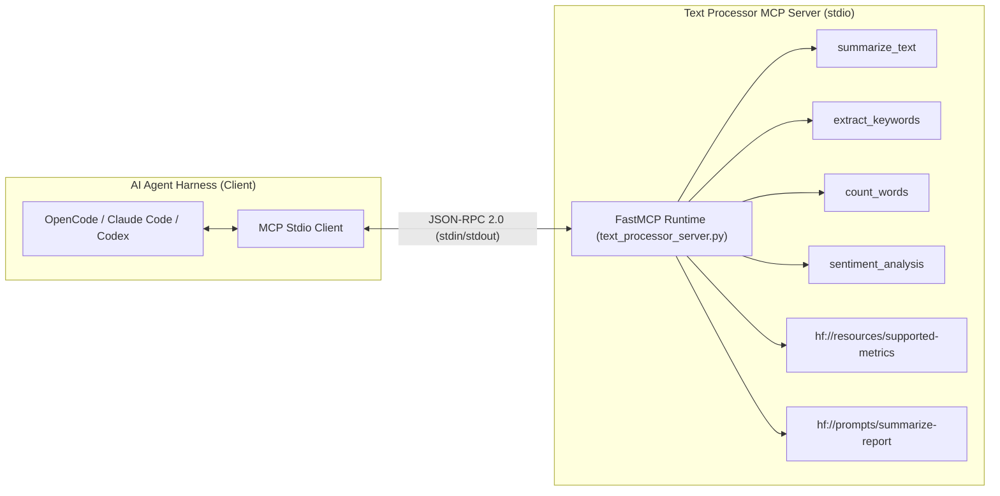

# Architecture & Technical Design: Text Processor MCP

## System Overview

Text Processor MCP is a Model Context Protocol (MCP) server implemented in Python using the official `mcp` SDK (FastMCP framework). It runs over a standard JSON-RPC 2.0 transport over standard input/output (`stdio`), providing contextual text transformation primitives to AI agent harnesses (Claude Code, OpenCode, Codex).

---

## Component Details

### 1. FastMCP Server Core (`server/text_processor_server.py`)
- Initializes the server instance: `mcp = FastMCP("text-processor-mcp")`.
- Decorators `@mcp.tool()`, `@mcp.resource()`, and `@mcp.prompt()` register protocol handlers.
- Pure Python algorithms ensure deterministic execution without external network latency or paid API requirements.

### 2. Capabilities & Tools
- `summarize_text(text: str, max_sentences: int = 3) -> str`: Extractive summarization scoring sentences by lexical relevance.
- `extract_keywords(text: str, top_k: int = 5) -> list[str]`: Frequency-based keyword extractor with stop-word filtering.
- `count_words(text: str) -> dict`: Multi-metric token, line, character, and sentence counter.
- `sentiment_analysis(text: str) -> dict`: Lexicon-based sentiment analyzer computing positive, negative, and neutral polarity scores.

### 3. Resources & Prompts
- **Resource**: `hf://resources/supported-metrics` returns JSON documentation of counting and sentiment metrics.
- **Prompt**: `hf://prompts/summarize-report` generates standardized analytical summary prompts with configurable style instructions.

---

## Transport & Protocol Specs

- **Transport**: JSON-RPC 2.0 over `stdio`.
- **Initialization Handshake**: Handled transparently by FastMCP (`protocolVersion: "2024-11-05"`).
- **Diagnostics**: Server logs to `stderr` only, preventing stream corruption of JSON-RPC standard output.
