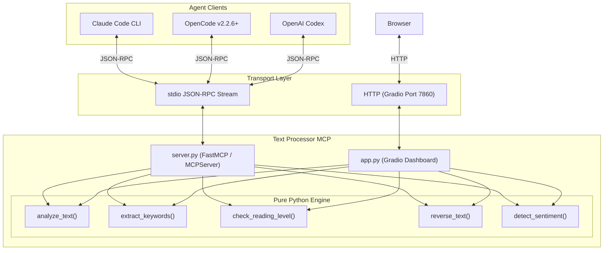

# Text Processor MCP Server (`text-processor-mcp`)

> **Model Context Protocol (MCP) server providing real-time text analytics, readability scoring, keyword extraction, and sentiment heuristic evaluation over stdio and Gradio.**

Official practical implementation for **Unit 2: MCP — The Model Context Protocol** of the Hugging Face Context Engineering Course.

---

## 1. Problem Statement

Autonomous code agents frequently require lightweight linguistic capabilities—such as determining whether a file is beginner-friendly, summarizing key entities, or measuring lexical density—without needing expensive external API calls or high-latency LLM self-reflection prompts.

Standardizing these capabilities as **Model Context Protocol (MCP)** tools allows any compliant code agent (Claude Code, OpenAI Codex, OpenCode, Cursor) to dynamically discover, inspect, and invoke these tools deterministically via `stdio`.

---

## 2. Objectives & Key Capabilities

- **MCP Compliance**: Native implementation utilizing `FastMCP` / `MCPServer` over standard input/output (`stdio`).
- **5 Specialized Linguistic Tools**:
  1. `analyze_text`: Computes word count, character count, sentence count, average word length, average sentence length, and vocabulary uniqueness.
  2. `extract_keywords`: Stopword-filtered frequency extraction returning ranked topical keywords.
  3. `check_reading_level`: Flesch-Kincaid Grade Level and Reading Ease categorization.
  4. `reverse_text`: Fast string inversion utility.
  5. `detect_sentiment`: Heuristic lexicon-based polarity scoring and valence categorization.
- **Dual-Headed Architecture**: Exposes tools over stdio for agents while simultaneously providing a reactive Gradio browser dashboard for human testing.
- **Zero External API Cost**: All analytical algorithms execute purely locally using the Python standard library.

---

## 3. Architecture Overview



---

## 4. Technology Stack

- **Runtime**: Python 3.12+
- **Protocol**: Model Context Protocol (MCP) Specification
- **Core Library**: `mcp >= 1.0.0` (`mcp.server.fastmcp`)
- **Web UI**: `gradio >= 4.0.0`
- **Testing**: `pytest >= 7.0.0`

---

## 5. Repository Structure

```
text-processor-mcp/
├── server.py              # FastMCP server exposing 5 tools over stdio
├── app.py                 # Gradio interactive web UI for browser experimentation
├── requirements.txt       # Dependencies (mcp, gradio, pytest)
├── README.md              # Comprehensive technical documentation
├── ARCHITECTURE.md        # MCP protocol mechanics & design specifications
├── CONTRIBUTING.md        # Developer setup and contribution guidelines
├── CHANGELOG.md           # Release history and tool updates
├── .env.example           # Example configuration variables
└── tests/
    └── test_text_processor.py # 9 unit tests verifying tools and MCP registration
```

---

## 6. Installation Instructions

```bash
# Navigate to project directory
cd course-workspace/unit2-mcp/text-processor-mcp

# Install dependencies in your virtual environment
pip install -r requirements.txt
```

---

## 7. Configuration & Environment Variables

No external API keys are required. Optional runtime settings:

| Variable | Description | Default |
| :--- | :--- | :--- |
| `MCP_PORT` | Port for Gradio web interface | `7860` |
| `MCP_HOST` | Host address for Gradio server | `127.0.0.1` |

See `.env.example`.

---

## 8. Exact Run Commands

### 1. Launch Stdio MCP Server (For Agent Consumption)
```bash
python server.py
```
*(Listens on stdin/stdout for MCP JSON-RPC protocol messages.)*

### 2. Launch Interactive Gradio Dashboard (For Human Testing)
```bash
python app.py
```
Open your browser at `http://127.0.0.1:7860` to interact with all 5 tools visually.

### 3. Registering with OpenCode
Add the server definition to your workspace `opencode.json`:
```json
{
  "mcp": {
    "text-processor": {
      "type": "local",
      "command": [
        "python",
        "C:/Users/nares/workspace/context-course/course-workspace/unit2-mcp/text-processor-mcp/server.py"
      ]
    }
  }
}
```
Verify status:
```bash
opencode mcp list
# Expected: ✓ text-processor connected
```

---

## 9. API & Tool Specifications

### 1. `analyze_text(text: str) -> str`
- **Input**: Raw text block.
- **Output**: JSON string containing `words`, `characters`, `sentences`, `avg_word_length`, `avg_sentence_length`, `unique_words`.

### 2. `extract_keywords(text: str, count: int = 5) -> str`
- **Input**: Raw text block, integer count (default: 5).
- **Output**: Formatted list of top keywords by frequency, ignoring 50+ common English stopwords.

### 3. `check_reading_level(text: str) -> str`
- **Input**: Raw text block.
- **Output**: Flesch-Kincaid Grade Level, Flesch Reading Ease score, and audience category (`Elementary`, `Middle School`, `High School`, `College/Academic`).

### 4. `reverse_text(text: str) -> str`
- **Input**: Raw text block.
- **Output**: Inverted character string.

### 5. `detect_sentiment(text: str) -> str`
- **Input**: Raw text block.
- **Output**: Polarity score (`-1.0` to `+1.0`), positive/negative word counts, and valence label (`Positive`, `Negative`, `Neutral`).

---

## 10. Usage Examples

### Programmatic Invocation (Python):
```python
from server import analyze_text, check_reading_level, detect_sentiment

text = "Autonomous agents provide tremendous leverage for context engineering."

# Readability
print(check_reading_level(text))
# Output: Grade Level: 14.8 | Ease: 18.2 | Category: College/Academic

# Sentiment
print(detect_sentiment(text))
# Output: Sentiment: Positive (Score: 0.125)
```

---

## 11. Testing Instructions & Verified Results

Execute the automated test suite with `pytest`:

```bash
python -m pytest tests/test_text_processor.py -v
```

### Verified Results:
```
============================= test session starts =============================
platform win32 -- Python 3.12.10, pytest-9.1.1
collected 9 items

tests/test_text_processor.py::TestTextProcessorTools::test_analyze_text_basic PASSED [ 11%]
tests/test_text_processor.py::TestTextProcessorTools::test_analyze_text_empty PASSED [ 22%]
tests/test_text_processor.py::TestTextProcessorTools::test_extract_keywords PASSED [ 33%]
tests/test_text_processor.py::TestTextProcessorTools::test_check_reading_level_levels PASSED [ 44%]
tests/test_text_processor.py::TestTextProcessorTools::test_check_reading_level_empty PASSED [ 55%]
tests/test_text_processor.py::TestTextProcessorTools::test_reverse_text PASSED [ 66%]
tests/test_text_processor.py::TestTextProcessorTools::test_detect_sentiment PASSED [ 77%]
tests/test_text_processor.py::TestMCPServerStructure::test_server_instance PASSED [ 88%]
tests/test_text_processor.py::TestMCPServerStructure::test_registered_tools PASSED [100%]

============================== 9 passed in 1.62s ==============================
```

---

## 12. Security Considerations

- **Stdio Boundary**: Operates strictly via stdin/stdout IPC without listening on untrusted external network sockets.
- **No Disk Mutation**: None of the exposed tools perform filesystem writes or execute system shell binaries.
- **Input Bounds**: Syllable and sentence parsers execute bounded linear loops protected against quadratic regex denial of service (ReDoS).

---

## 13. Known Limitations

- Syllable counting utilizes an English-centric vowel-group heuristic; multi-lingual text will yield approximate grade scores.
- Sentiment detection is lexicon-based; sarcasm, nuanced contextual irony, and domain jargon require transformer embeddings.

---

## 14. Roadmap & Future Improvements

- [ ] Support multilingual stopword filtering and reading formulas (SMOG, Gunning fog).
- [ ] Implement SSE transport mode alongside stdio for remote agent access.
- [ ] Add caching for repeated keyword queries on long documentation files.

---

## 15. License & Attribution

- **License**: Apache 2.0
- **Attribution**: Created as part of the Hugging Face Context Engineering Course (Unit 2: MCP). Implements the Anthropic / Linux Foundation Model Context Protocol.
