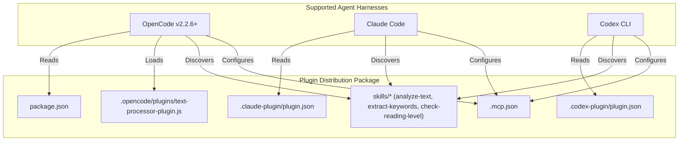

# Architecture & Technical Design: Text Processor Plugin

## Overview

Text Processor Plugin is a cross-agent plugin distribution unifying Agent Skills, Model Context Protocol (MCP) server bindings, and runtime lifecycle hooks.



## Directory Structure Specification

- `.claude-plugin/plugin.json`: Standard metadata file for Anthropic Claude Code plugin discovery.
- `.codex-plugin/plugin.json`: Metadata and skill manifest for OpenAI Codex CLI environments.
- `package.json`: Node.js ES module declaration exposing the plugin setup entrypoint.
- `.mcp.json`: Auto-configuration file declaring the `text-processor` MCP server.
- `skills/`: Standard agent skills following the open Agent Skills specification (YAML frontmatter + Markdown instructions).
- `.opencode/plugins/text-processor-plugin.js`: Code-first hook export returning `{ id, setup }`.

## Runtime Hook Lifecycle

The JavaScript plugin module implements OpenCode's plugin API:
```javascript
export const TextProcessorPlugin = {
  id: "text-processor-plugin",
  setup: async (ctx) => {
    // 1. Log initialization
    // 2. Register custom command /text-stats
    // 3. Return lifecycle listeners ("tool.execute.before")
  }
};
```
