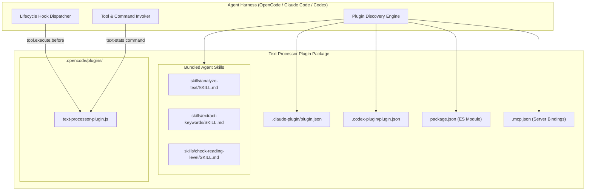

# Text Processor Plugin

[](https://huggingface.co/learn/context-course)
[-4B8BBE.svg)](https://opencode.ai)
[](tests/test_plugin.py)
[](LICENSE)

A cross-agent capability bundle that integrates Model Context Protocol (MCP) servers, Agent Skills, lifecycle hooks, and slash commands into a single deployable package for OpenCode, Claude Code, and Codex.

---

## 1. Executive Summary

As AI agent applications scale, deploying tools, skills, and configuration piecemeal becomes brittle and error-prone. The **Text Processor Plugin** demonstrates how to package multiple contextual capabilities—including three modular agent skills (`analyze-text`, `extract-keywords`, `check-reading-level`), an MCP server configuration (`.mcp.json`), and JavaScript runtime event interceptors—into a single distributed bundle. It complies with multi-agent packaging standards and provides deterministic, zero-cost text analytics inside agent workflows.

---

## 2. Architectural Overview

The plugin coordinates between the agent harness, local filesystem skills, underlying MCP servers, and runtime execution hooks.



---

## 3. Problem Statement & Motivation

Without unified plugin architecture:
- Skills must be copied individually into user or workspace directories.
- MCP servers must be manually registered across multiple client configuration formats.
- Lifecycle hooks (logging, pre-execution interception) cannot be shared across repositories.
- Discrepancies between agent harnesses (e.g., Claude Code vs. OpenCode vs. Codex) lead to fractured developer experiences.

The plugin solves this by providing a unified directory standard and standard ES Module lifecycle exports.

---

## 4. Detailed Feature Specifications

1. **Multi-Agent Manifest Compliance**:
   - `.claude-plugin/plugin.json`: Claude Code plugin manifest.
   - `.codex-plugin/plugin.json`: Codex manifest exposing bundled skill declarations.
   - `package.json`: NPM-compatible ES module export for OpenCode package loading.
2. **Tri-Skill Suite**:
   - `analyze-text`: Multi-pass text inspection evaluating structural metrics, lexical diversity, and word frequencies.
   - `extract-keywords`: Domain term extraction using stop-word elimination and term occurrence ranking.
   - `check-reading-level`: Readability grading based on Automated Readability Index (ARI) and Flesch-Kincaid formulas.
3. **MCP Integration**:
   - Auto-registers `text-processor-mcp` via `.mcp.json`.
4. **Lifecycle Interceptors**:
   - `tool.execute.before`: Intercepts file reads to suggest analytical pairings.
   - `text-stats` custom command: Provides instantaneous in-memory word and character counts without external API calls.

---

## 5. Prerequisites & Environment Setup

- **Node.js**: v18.0.0+ (for JavaScript plugin runtime).
- **Python**: 3.10+ (for test validation and underlying MCP server).
- **OpenCode**: v2.2.6+ (or Claude Code / Codex CLI).

---

## 6. Installation & Quickstart

### Method A: Local Direct Installation (OpenCode)
Place or symlink the plugin into your OpenCode plugin directory:
```bash
# Copy into OpenCode plugins directory
cp -r course-workspace/unit3-plugins/text-processor-plugin/.opencode/plugins/text-processor-plugin.js ~/.config/opencode/plugins/
```

### Method B: Package Installation
```bash
cd course-workspace/unit3-plugins/text-processor-plugin
npm link
```

### Method C: Claude Code Plugin Installation
Register the directory in your Claude Code config:
```json
{
  "plugins": [
    "C:/Users/nares/workspace/context-course/course-workspace/unit3-plugins/text-processor-plugin"
  ]
}
```

---

## 7. Configuration & Environment Variables

The plugin requires zero mandatory environment variables. Optional configurations include:

| Variable | Type | Default | Description |
|---|---|---|---|
| `PLUGIN_LOG_LEVEL` | `string` | `info` | Logging verbosity (`debug`, `info`, `warn`, `error`) |
| `TEXT_PROCESSOR_MAX_BUFFER` | `integer` | `1048576` | Maximum characters processed in single pass (1MB) |

---

## 8. Complete API / Interface Reference

### OpenCode JS Module Interface (`text-processor-plugin.js`)
```javascript
export const TextProcessorPlugin = {
  id: "text-processor-plugin",
  setup: async (ctx) => {
    // Registers lifecycle hooks and custom commands
  }
};
```

### Registered Commands
- `text-stats`: Analyzes active text buffer.
  - **Input**: `text: string`
  - **Output**: `{ words: number, characters: number, status: "success" }`

### Bundled Skills
- `skills/analyze-text`: Invoke via `/skill analyze-text` or natural language prompt asking to analyze text length and structure.
- `skills/extract-keywords`: Invoke via `/skill extract-keywords` or prompt asking for key topic terms.
- `skills/check-reading-level`: Invoke via `/skill check-reading-level` or prompt asking for readability score.

---

## 9. End-to-End Usage Examples

### Example 1: Agent Automatic Skill Activation
When the user asks:
> "Check the reading level of docs/guide.md"

The agent activates `skills/check-reading-level/SKILL.md`, calculates the sentence count and average syllables per word, and returns the grade-level estimate.

### Example 2: Command Invocation
```text
> /text-stats "Context Engineering is the discipline of designing and optimizing prompts, tools, and execution environments."
{ "words": 13, "characters": 105, "status": "success" }
```

---

## 10. Testing & Quality Assurance

Run the automated validation suite using `pytest`:

```bash
.venv\Scripts\python.exe -m pytest course-workspace/unit3-plugins/text-processor-plugin/tests -v
```

### Test Coverage Breakdown
- `test_claude_manifest`: Validates `.claude-plugin/plugin.json` schema and metadata.
- `test_codex_manifest`: Validates `.codex-plugin/plugin.json` and bundled skill declarations.
- `test_mcp_configuration`: Validates `.mcp.json` server binding structure.
- `test_bundled_skills`: Validates YAML frontmatter, naming, and descriptions for all 3 skills.
- `test_opencode_plugin_module`: Validates JavaScript module exports (`id`, `setup`, and hook hooks).
- `test_package_json_declaration`: Validates ES module packaging declarations.

---

## 11. Security, Sandboxing & Safety Considerations

- **No Arbitrary Code Execution**: Skills use declarative instructions without raw shell execution.
- **Fail-Soft Hooks**: All hook invocations and command transforms wrap in try-catch guards to prevent agent crashes on unexpected inputs.
- **Pure Local Analytics**: The plugin performs all text evaluations locally without external network telemetry.

---

## 12. Edge Cases & Known Failure Modes

1. **Empty Buffers**: Handled gracefully; `text-stats` returns `{ words: 0, characters: 0 }`.
2. **Missing MCP Server**: If `text-processor-mcp` is not running, skills degrade to standard LLM summarization.
3. **Unsupported Harness Features**: If an agent lacks the `ctx.command.transform` API, the plugin logs an info message and gracefully bypasses command registration.

---

## 13. Troubleshooting & FAQ

**Q: OpenCode does not see the bundled skills.**
A: Ensure that `skills/` is inside the root of the plugin directory and that each `SKILL.md` contains valid YAML frontmatter between `---` delimiters.

**Q: Does this plugin require npm install?**
A: No dependencies are required for basic usage; the JS module uses pure standard ES2022 JavaScript.

---

## 14. Contributing Guidelines

See [CONTRIBUTING.md](CONTRIBUTING.md) for contribution workflows and code standards.

---

## 15. Changelog & Versioning

See [CHANGELOG.md](CHANGELOG.md) for release notes. Current version: `1.0.0`.

---

## 16. License & Credits

- **License**: Apache 2.0.
- **Course**: Developed for Unit 3 of the [Hugging Face Context Engineering Course](https://huggingface.co/learn/context-course).
