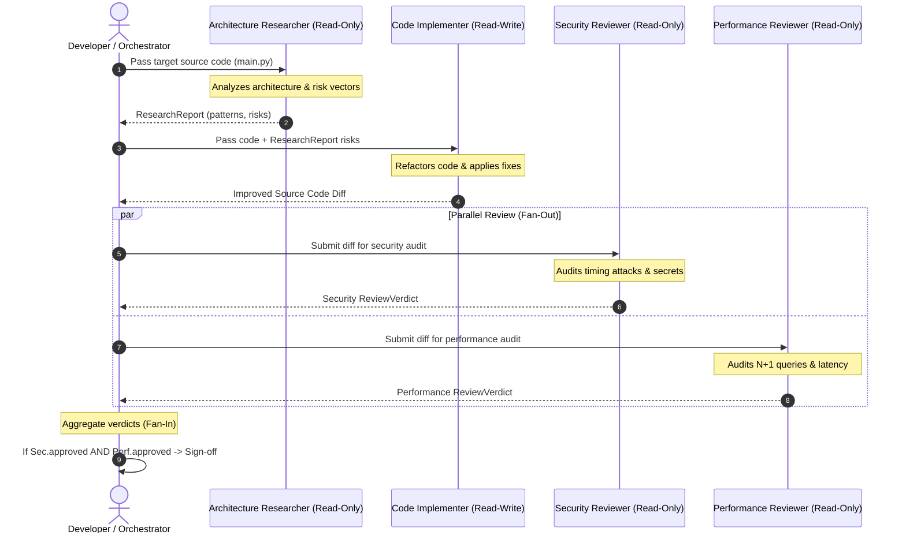

# Architecture & Technical Design: Code Quality Multi-Agent Pipeline

## Overview

The Code Quality Multi-Agent Pipeline models a production engineering department using specialized AI agent personas. It implements two canonical agentic interaction topologies:
1. **Sequential Handoff**: Researcher $\rightarrow$ Implementer.
2. **Fan-Out / Fan-In**: Implementer $\rightarrow$ [Security Reviewer, Performance Reviewer] $\rightarrow$ Orchestrator.

---

## Agent Personas & Sandbox Policies

| Agent Persona | Configuration | Tools Permitted | Sandboxing & Permissions |
|---|---|---|---|
| **Researcher** | `.claude/agents/researcher.md` `.codex/agents/researcher.toml` | `Read`, `Grep`, `Glob` | Strictly Read-Only. No file mutation or execution. |
| **Implementer** | `.claude/agents/implementer.md` `.codex/agents/implementer.toml` | `Read`, `Write`, `Edit` | Scoped to project working tree. |
| **Security Reviewer** | `.claude/agents/security-reviewer.md` `.codex/agents/security-reviewer.toml` | `Read`, `Grep` | Strictly Read-Only. Enforces constant-time checks & credential safety. |
| **Performance Reviewer** | `.claude/agents/performance-reviewer.md` `.codex/agents/performance-reviewer.toml` | `Read`, `Grep` | Strictly Read-Only. Detects query loops & memory leaks. |

---

## Orchestrator Core (`pipeline_runner.py`)

- `execute_pipeline()` orchestrates lifecycle stages.
- Concurrent execution of reviewers via Python `concurrent.futures.ThreadPoolExecutor`.
- Fallback heuristic analysis guarantees zero-token testability for CI/CD environments.
