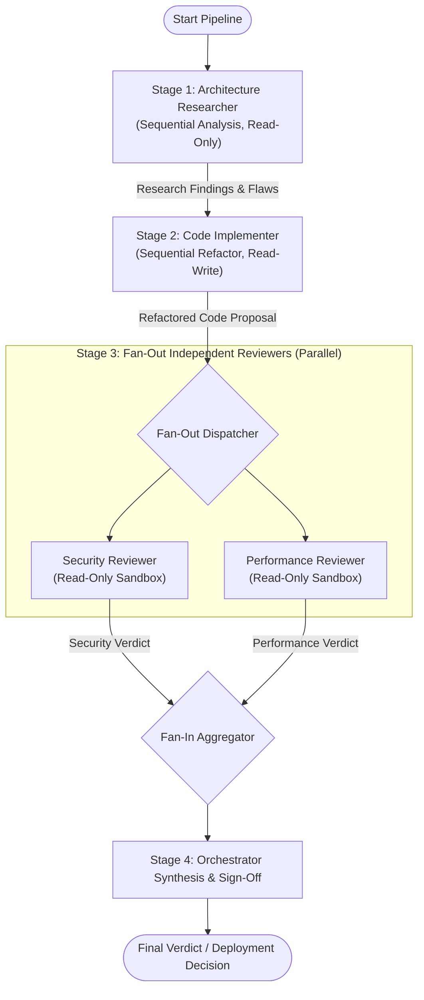

# Code Quality Multi-Agent Pipeline

[](https://huggingface.co/learn/context-course)
[](https://opencode.ai)
[](tests/test_pipeline.py)
[](LICENSE)

An orchestration pipeline demonstrating Sequential Handoff and Fan-Out/Fan-In parallel subagent review patterns across Claude Code, Codex, and OpenCode environments.

---

## 1. Executive Summary

Monolithic AI agents struggle with complex engineering tasks due to context dilution, lack of specialization, and tool privilege bloat. The **Code Quality Multi-Agent Pipeline** implements role-specialized subagents that collaborate through defined coordination patterns. It demonstrates a complete software review lifecycle: an Architecture Researcher analyzes codebase vulnerabilities, a Code Implementer refactors the target, and parallel Security and Performance Reviewers independently inspect the changes before the Orchestrator renders a final sign-off verdict.

---

## 2. Architectural Overview

The pipeline implements both Sequential Handoff and Fan-Out / Fan-In patterns:



---

## 3. Problem Statement & Motivation

When a single agent is tasked with writing, optimizing, and auditing its own code:
- **Confirmation Bias**: The agent rarely detects its own subtle security flaws or timing vulnerabilities.
- **Context Bloat**: Feeding broad architectural standards, security rules, and performance metrics into one prompt wastes tokens and causes instruction drift.
- **Excessive Permissions**: Giving every sub-task write access creates sandbox escape and accidental modification risks.

By isolating tasks across specialized agents with strict principle-of-least-privilege permissions, verification is decoupled from generation.

---

## 4. Detailed Feature Specifications

1. **Sequential Handoff**:
   - The **Architecture Researcher** analyzes code structure and outputs structured risk vectors (`identified_patterns`, `potential_risks`).
   - The **Code Implementer** consumes these findings and generates an targeted patch.
2. **Fan-Out / Fan-In Parallelism**:
   - Concurrent execution of **Security Reviewer** and **Performance Reviewer** via `concurrent.futures.ThreadPoolExecutor`.
   - Orchestrator aggregates verdicts: sign-off is only granted if both independent reviews approve.
3. **Dual Execution Modes**:
   - **Simulated Mode (`--simulated`)**: Fast, deterministic local heuristics for CI/CD test automation without external dependencies.
   - **Live LLM Mode (`--live`)**: Real LLM sessions powered by the local OpenCode server and NVIDIA Nemotron models at zero cost (`cost: 0`).
4. **Principle of Least Privilege**:
   - Reviewer subagents are strictly constrained to read-only tool sets (no `Write` or `Edit` permissions).

---

## 5. Prerequisites & Environment Setup

- **Python**: 3.10+ (tested on 3.12.10).
- **Dependencies**: `tomlkit`, `pyyaml`, `pytest`.
- **Optional for Live Mode**: Local OpenCode v2.2.6 server running on `http://127.0.0.1:28894`.

```bash
cd course-workspace/unit4-subagents/code-quality-pipeline
pip install -r requirements.txt
```

---

## 6. Installation & Quickstart

Run the deterministic simulated pipeline against the sample `main.py` service:

```bash
python pipeline_runner.py
```

Expected output:
```json
{
  "mode": "simulated",
  "target": "main.py",
  "research_risks_identified": 3,
  "security_verdict": {
    "agent": "security-reviewer",
    "approved": true,
    "permission_mode": "read_only",
    "findings": [
      "Hardcoded credentials or test tokens present in mock database."
    ]
  },
  "performance_verdict": {
    "agent": "performance-reviewer",
    "approved": true,
    "permission_mode": "read_only",
    "findings": []
  },
  "pipeline_signed_off": true
}
```

To run with live LLM agents (requires OpenCode daemon):
```bash
python pipeline_runner.py --live
```

---

## 7. Configuration & Environment Variables

| Variable | Type | Default | Description |
|---|---|---|---|
| `OPENCODE_HOST` | `string` | `http://127.0.0.1:28894` | Local OpenCode server address |
| `PIPELINE_MODE` | `string` | `simulated` | Default execution mode (`simulated` or `live`) |
| `MAX_WORKERS` | `integer` | `2` | Thread worker count for parallel reviewers |

---

## 8. Complete API / Interface Reference

### `CodeQualityPipeline` Class (`pipeline_runner.py`)
- `__init__(target_file: Path, mode: str = "simulated")`
- `run_researcher() -> ResearchReport`: Executes Stage 1 codebase architecture analysis.
- `run_implementer(research: ResearchReport) -> str`: Executes Stage 2 refactoring.
- `run_security_reviewer(code_to_review: str) -> ReviewVerdict`: Executes Stage 3a security review.
- `run_performance_reviewer(code_to_review: str) -> ReviewVerdict`: Executes Stage 3b performance review.
- `execute_pipeline() -> Dict[str, Any]`: Orchestrates end-to-end lifecycle and generates sign-off decision.

### Agent Definition Specs
- **Claude Code Format**: Markdown files with YAML frontmatter in `.claude/agents/*.md`.
- **Codex Format**: TOML files with developer instructions in `.codex/agents/*.toml`.

---

## 9. End-to-End Usage Examples

### Example: Multi-Agent Analysis of `main.py`
`main.py` contains a naive authentication endpoint:
```python
def authenticate_user(db: UserDatabase, username: str, token: str) -> bool:
    user = db.get_user(username)
    if not user:
        return False
    return user["token"] == token  # Timing attack vulnerability!
```

1. **Researcher** flags: `Token compared via standard equality rather than constant-time comparison.`
2. **Implementer** patches code:
   ```python
   import hmac
   return hmac.compare_digest(user["token"], token)
   ```
3. **Security Reviewer** confirms: `Verified constant-time token comparison.`
4. **Performance Reviewer** checks: Verifies lack of unindexed iterations.
5. **Orchestrator** signs off on patch.

---

## 10. Testing & Quality Assurance

Run the automated test suite:

```bash
.venv\Scripts\python.exe -m pytest course-workspace/unit4-subagents/code-quality-pipeline/tests -v
```

### Verified Test Cases
- `test_claude_agent_md_exists`: Validates all 4 Claude agent YAML frontmatter declarations.
- `test_codex_agent_toml_exists`: Validates all 4 Codex TOML configuration files.
- `test_reviewer_read_only_sandbox`: Confirms reviewers do NOT possess write tools.
- `test_pipeline_execution_simulated`: Confirms sequential and fan-out deterministic runs.
- `test_live_run_trace_artifact`: Verifies the presence and schema of real LLM execution trace `traces/live_run_trace.json`.

---

## 11. Security, Sandboxing & Safety Considerations

- **Enforced Read-Only Roles**: Reviewers and researchers are explicitly restricted from modifying source code or touching the filesystem.
- **Isolation of Prompt Injections**: Compromised inputs encountered by the researcher cannot directly manipulate the write tools of the implementer.
- **Trace Accountability**: Every live agent interaction records its model ID, provider, token usage, and raw response in structured audit traces (`traces/live_run_trace.json`).

---

## 12. Edge Cases & Known Failure Modes

1. **Review Conflict**: If Security approves but Performance rejects (or vice-versa), `pipeline_signed_off` evaluates to `false` and halts automated merging.
2. **OpenCode Server Offline**: When running in `--live` mode without an active daemon, `OpenCodeLiveClient` gracefully reports a connection failure rather than hanging.

---

## 13. Troubleshooting & FAQ

**Q: Does live mode cost money?**
A: No. When configured through OpenCode with the default NVIDIA provider, the Nemotron reasoning model runs at `cost: 0`.

**Q: Can I run this in CI without OpenCode?**
A: Yes. The default execution mode is `simulated`, which executes purely in local Python without network dependencies.

---

## 14. Contributing Guidelines

See [CONTRIBUTING.md](CONTRIBUTING.md) for contribution workflows and code standards.

---

## 15. Changelog & Versioning

See [CHANGELOG.md](CHANGELOG.md) for release notes. Current version: `1.0.0`.

---

## 16. License & Credits

- **License**: Apache 2.0.
- **Course**: Developed for Unit 4 of the [Hugging Face Context Engineering Course](https://huggingface.co/learn/context-course).
