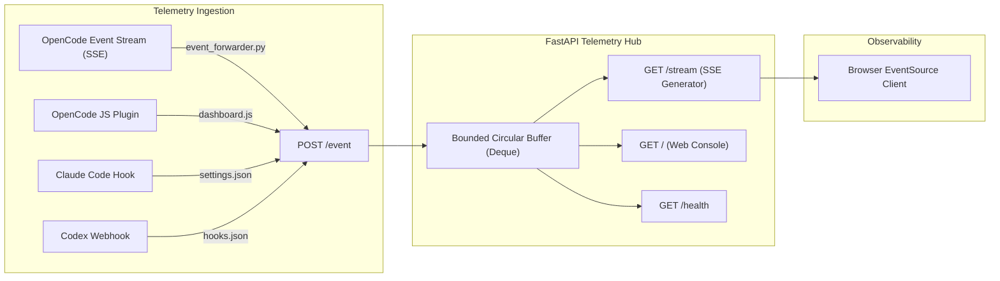

# Architecture & Technical Design: Agent Activity Dashboard

## Overview

The Agent Activity Dashboard is a real-time event aggregation and streaming server tailored for AI agent activity observability. It bridges multiple proprietary and open agent execution platforms into a single unified telemetry pipeline.

---

## Core Components

### 1. Ingestion Engine (`app.py`)
- Built on FastAPI for high-throughput asynchronous request handling.
- Implements `POST /event` to receive JSON payloads:
  - Normalizes timestamps, platforms, and event names.
  - Truncates oversized arguments to 200 characters to prevent buffer bloat.
  - Maintains a thread-safe circular event buffer with configurable capacity.

### 2. SSE Streaming Engine
- Implements `GET /stream` using `starlette.responses.StreamingResponse` emitting `text/event-stream`.
- Dispatches new events to all connected clients asynchronously.

### 3. OpenCode Native SSE Bridge (`event_forwarder.py`)
- Connects directly to the running OpenCode daemon's `/api/event` SSE endpoint.
- Normalizes native engine events into unified course taxonomy (`SessionStart`, `PreToolUse`, `PostToolUse`, `Stop`).
- Wrapped in complete fail-soft exception guards.
