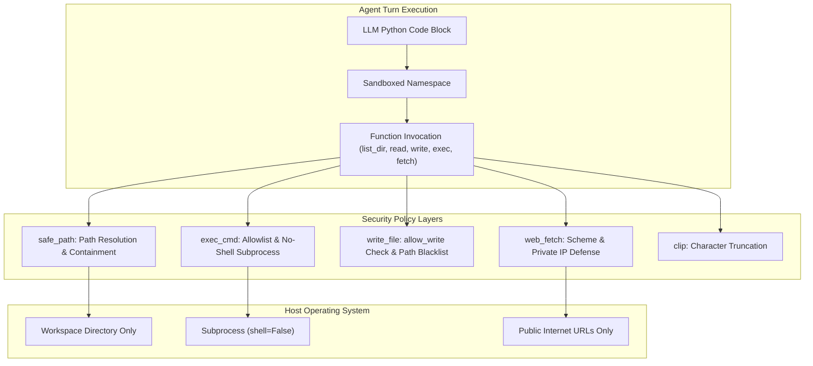

# Architecture & Technical Design: Nano Harness

## Overview

Nano Harness is a minimal, hardened execution harness designed for autonomous AI agents that operate via Python code-first interactions. It enforces strict boundary controls to guarantee host safety.

---

## Defensive Guardrails

### 1. Filesystem Confinement (`safe_path`)
- All user-supplied paths are decoded (`urllib.parse.unquote`) and tested for null bytes.
- Resolves candidates against `workspace` root using `Path.resolve()`.
- Validates that `candidate.relative_to(workspace)` raises no `ValueError`.
- Checks symlink targets to prevent symbolic link traversal.

### 2. Command Sandboxing (`exec_cmd`)
- Commands must match an explicit allowlist of binary names.
- Explicit path invocations (`/bin/sh`, `C:\Windows\...`) are blocked.
- Commands run with `shell=False`.
- Arguments are scanned for forbidden shell metacharacters (`;`, `&&`, `|`, etc.).

### 3. Network Protection (`web_fetch`)
- Scheme restricted strictly to `http` and `https`.
- Hostname is resolved via `socket.getaddrinfo` and validated against `ipaddress.is_private`, `is_loopback`, `is_link_local`, `is_reserved`, and `is_multicast`.

### 4. Context Budgeting (`clip`)
- Output from commands, files, and web fetches is capped at `max_chars` to preserve prompt space and avoid token exhaustion.
