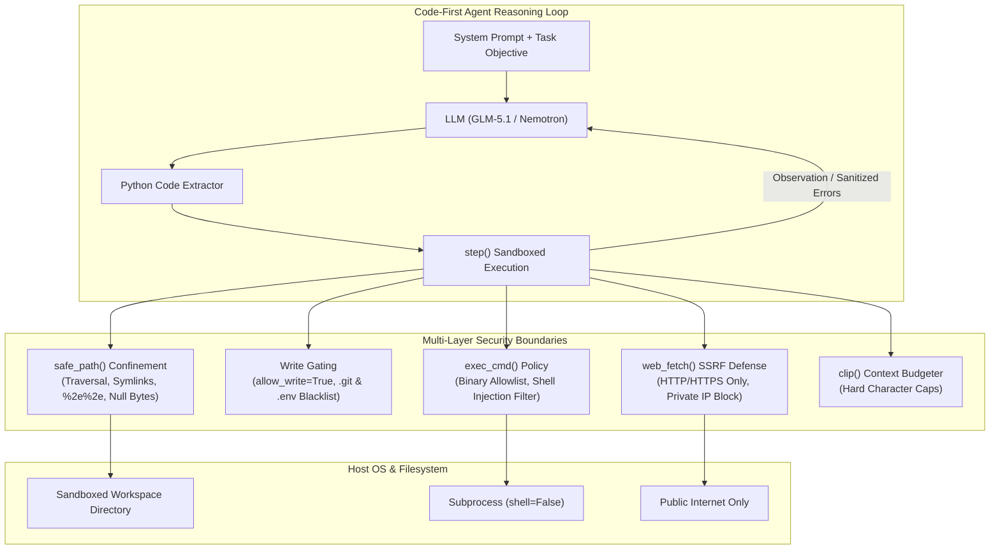

# Nano Harness: Code-First Hardened Agent Sandbox

[-FFD21E.svg)](https://huggingface.co/learn/context-course)
[](https://opencode.ai)
[](tests/test_nano_harness.py)
[](LICENSE)

A minimal, robust autonomous agent execution harness implementing code-first interaction, strict filesystem confinement, command allowlisting, SSRF protection, and context window budgeting.

---

## 1. Executive Summary

Autonomous coding agents present significant host security risks when granted unbounded shell and filesystem privileges. The **Nano Harness** implements the code-first agent design pattern described in Unit 6 of the Hugging Face Context Engineering Course. Instead of executing arbitrary shell scripts, the agent outputs concise Python snippets executed within a hardened namespace equipped with multi-layered defenses: path confinement, write gating, command allowlisting, network SSRF defense, context budgeting, and sanitized error reporting.

---

## 2. Architectural Overview



---

## 3. Problem Statement & Motivation

Traditional agent harnesses that allow raw bash execution expose host environments to:
1. **Directory Traversal**: Relative escapes (`../../`) or symlinks leaking host credentials (`~/.ssh`, `/etc/passwd`).
2. **Command Injection**: Shell metacharacters (`&&`, `;`, `|`, `` ` ``) executing unvetted binaries.
3. **SSRF Exploits**: Fetching internal services (e.g., AWS metadata at `169.254.169.254` or local daemons).
4. **Context Overflow**: Multi-megabyte tool outputs flooding the context window and breaking agent coherence.
5. **Accidental Mutation**: Destructive overwrites of sensitive files like `.git/config` or `.env`.

Nano Harness implements active, layered defense-in-depth mitigations against each vector.

---

## 4. Detailed Feature Specifications

1. **Strict Path Confinement (`safe_path`)**:
   - Enforces relative path resolution using `Path.resolve().relative_to(workspace)`.
   - Rejects null bytes (`\0`), URL-encoded sequences (`%2e%2e`), and symlink escapes pointing outside the root.
2. **Command Allowlist & Injection Filtering (`exec_cmd`)**:
   - Strict binary allowlist (`ls`, `cat`, `pwd`, `echo`, `head`, `tail`, `wc`, `rg`).
   - Forbids absolute or relative path binaries (e.g. `/bin/sh` or `..\cmd.exe`).
   - Rejects shell metacharacters (`;`, `&&`, `||`, `|`, `>`, `<`, `` ` ``, `$()`, `${}`).
   - Disables shell interpolation (`shell=False`).
3. **Write Gating & Blacklist Protection (`write_file`)**:
   - Global write toggle (`allow_write: bool = False`).
   - Hardened blacklist rejecting mutations to `.git`, `.env`, `.ssh`, `.gnupg`, and `id_rsa`.
4. **Network Sandboxing & SSRF Defense (`web_fetch`)**:
   - Strictly enforces `http` and `https` schemes (blocking `file://`, `ftp://`, `gopher://`).
   - Resolves hostnames and blocks private, loopback, multicast, and link-local IP addresses (including `127.0.0.1`, `localhost`, `10.x.x.x`, and cloud metadata `169.254.169.254`).
5. **Context Budgeting (`clip`)**:
   - Caps tool observations to `max_chars` (default 8,000) with truncation notices.
6. **Error Sanitization (`sanitize_error`)**:
   - Redacts absolute host filesystem paths and user home directories (`<workspace>`, `<home>`) in error logs.

---

## 5. Prerequisites & Environment Setup

- **Python**: 3.10+ (tested on 3.12.10).
- Pure standard library implementation (no heavy third-party framework dependencies).
- Optional API key for Hugging Face Hub searches: `HF_TOKEN`.

---

## 6. Installation & Quickstart

```python
from pathlib import Path
from nano_harness import NanoHarness

# Initialize harness pinned to a safe workspace
workspace_dir = Path("./sandbox")
workspace_dir.mkdir(exist_ok=True)

harness = NanoHarness(
    workspace=workspace_dir,
    allow_write=True,
    allow_commands=["ls", "echo", "cat"]
)

# Execute sandboxed Python step
observation = harness.step("""
files = list_dir('.')
print('Workspace files:', files)
final_answer({'status': 'ready'})
""")

print(observation)
```

---

## 7. Configuration & Environment Variables

| Parameter / Variable | Type | Default | Description |
|---|---|---|---|
| `workspace` | `Path \| str` | *Required* | Confined root directory for agent operations |
| `allow_write` | `bool` | `False` | Write permission gate for `write_file` |
| `allow_commands` | `List[str]` | `['ls', 'cat', 'pwd', ...]` | Allowed shell binary names |
| `max_chars` | `int` | `8000` | Context character limit per observation |
| `timeout_s` | `int` | `30` | Subprocess and HTTP fetch timeout |
| `HF_TOKEN` | `string` | `""` | Optional Hugging Face API key for Hub tools |

---

## 8. Complete API / Interface Reference

### `NanoHarness` Class Methods
- `safe_path(path_str: str | Path) -> Path`: Resolves path and asserts containment.
- `list_dir(path: str = ".") -> List[str]`: Lists directory contents.
- `read_file(path: str, max_chars: int = 4000) -> str`: Reads bounded text.
- `write_file(path: str, content: str) -> str`: Writes text if authorized.
- `exec_cmd(args: List[str] | str) -> str`: Executes allowlisted command without shell.
- `web_fetch(url: str, max_bytes: int = 10000) -> str`: Fetches web content with SSRF filters.
- `hf_search(query: str, resource_type: str = "models", limit: int = 5) -> List[Dict]`: Searches Hub API.
- `final_answer(value: Any) -> Any`: Terminates agent loop with return value.
- `step(code_str: str) -> str`: Executes a single turn of Python code in the sandbox.

---

## 9. End-to-End Usage Examples

### Blocked Path Traversal
```python
>>> harness.step("read_file('../../etc/passwd')")
"Error: PermissionError: Access denied: path '../../etc/passwd' escapes workspace root."
```

### Blocked SSRF Cloud Metadata Request
```python
>>> harness.step("web_fetch('http://169.254.169.254/latest/meta-data')")
"stdout:\nError: SSRF protection: URL targets restricted or private host '169.254.169.254'."
```

### Blocked Command Chaining
```python
>>> harness.step("exec_cmd('echo safe; rm -rf /')")
"Error: PermissionError: Command chaining or shell metacharacter ';' is strictly forbidden."
```

---

## 10. Testing & Quality Assurance

Run the comprehensive security regression test suite:

```bash
.venv\Scripts\python.exe -m pytest course-workspace/unit6-nano-harness/tests -v
```

### Verified Test Cases (15/15 Passed)
- `test_safe_path_confinement`: Asserts traversal rejection.
- `test_path_traversal_variations`: Tests percent-encoded traversals and null-byte injection.
- `test_write_gating_disabled`: Verifies write prevention when `allow_write=False`.
- `test_write_gating_enabled`: Confirms authorized writes succeed.
- `test_write_restricted_files_forbidden`: Confirms `.git` and `.env` protection.
- `test_command_allowlist`: Confirms unlisted binaries are rejected.
- `test_command_injection_defense`: Tests chaining characters (`;`, `&&`, `|`, `$()`).
- `test_explicit_binary_path_forbidden`: Verifies `/bin/ls` and path-based calls are blocked.
- `test_output_clipping`: Verifies observation truncation.
- `test_forbidden_url_schemes`: Tests blocking of `file://` and `ftp://`.
- `test_ssrf_private_ip_blocking`: Tests blocking of `169.254.169.254`, `127.0.0.1`, and private networks.
- `test_step_list_and_read`: Verifies standard read operations.
- `test_step_final_answer`: Verifies task termination handling.
- `test_python_fence_extraction`: Tests parsing of markdown-fenced LLM replies.
- `test_sanitized_error_handling`: Verifies host path redaction.

---

## 11. Security, Sandboxing & Safety Considerations

- **Process Isolation**: Commands run with `shell=False`, preventing shell interpretation of command arguments.
- **SSRF Defense**: Both DNS resolution and IP address literals are evaluated before socket connections are created.
- **Fail-Closed Permissions**: By default, write access is disabled.

---

## 12. Edge Cases & Known Failure Modes

1. **Non-ASCII / Percent-Encoded Paths**: Handled by unquoting input paths before resolving.
2. **Infinite Loops**: Subprocess calls and HTTP fetches enforce strict timeouts (`timeout_s`).
3. **Memory Bloat**: Hard byte limits on read and fetch prevent memory exhaustion attacks.

---

## 13. Troubleshooting & FAQ

**Q: Can I allow git commands?**
A: Yes, pass `allow_commands=['git']` to the constructor, but note that `write_file` will still block overwriting `.git/config` directly.

**Q: Why are absolute paths in commands rejected?**
A: Direct binary paths (such as `/bin/bash` or `C:\cmd.exe`) bypass allowlist name resolution and are rejected by design.

---

## 14. Contributing Guidelines

See [CONTRIBUTING.md](CONTRIBUTING.md) for contribution workflows and code standards.

---

## 15. Changelog & Versioning

See [CHANGELOG.md](CHANGELOG.md) for release notes. Current version: `2.0.0`.

---

## 16. License & Credits

- **License**: Apache 2.0.
- **Course**: Developed for Unit 6 (Bonus) of the [Hugging Face Context Engineering Course](https://huggingface.co/learn/context-course).
